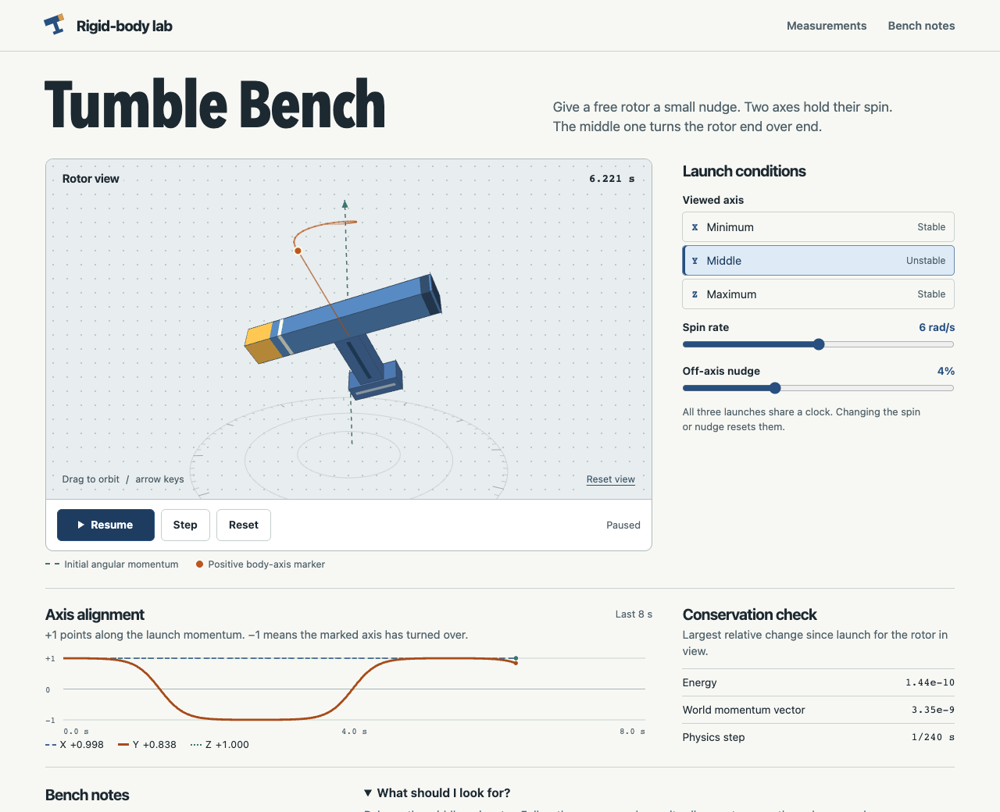

# Tumble Bench

Release the rotor, watch its orange marker turn through 180°, then select a different axis at the same instant. This browser experiment runs three torque-free launches side by side in time. Their shared alignment plot shows which rotations survive a small perturbation.

[Open the experiment](https://naxe-portfolio-review.vercel.app/labs/rigid-body/) · [Inspect the solver](web/physics.mjs) · [Measured results](web/benchmark.json)



## Try it

At the default 6 rad/s and 4% off-axis nudge, release **Middle**. The orange dot marks the positive body axis. The dashed arrow fixes the launch angular momentum in space. The first negative alignment sample occurs at **1.3292 s**. The marker continues toward the opposite pole. Switch to **Minimum** or **Maximum** and compare their traces on the same clock. With a zero nudge, all three exact-axis spins hold.

Drag the view or focus it and use the arrow keys. Home restores the camera. **Step** pauses playback and advances exactly 1/240 s. The page starts paused and pauses again when its tab is hidden.

## Run locally

The site is plain HTML, CSS and JavaScript. Serve just the `web/` directory from any static host. It requires no runtime packages or external services.

```sh
python3 -m http.server 8080 --directory web
```

Open [the local experiment](http://localhost:8080/). Run the numerical checks directly with Node.js 20 or later:

```sh
node scripts/benchmark.mjs --check-evidence
node scripts/benchmark.mjs --write    # regenerate web/benchmark.json
```

The optional Playwright suite exercises controls, pointer and keyboard orbit, the live flip, drift displays, the benchmark link, reduced-motion startup and viewport widths from 320 to 1280 px. It hosts the site on an ephemeral loopback port under its production subpath.

```sh
npm ci
npx playwright install chromium webkit
npm run test:browser
BROWSER_ENGINE=webkit npm run test:browser
```

## From dimensions to motion

The rotor consists of three touching rectangular solids of uniform density **2,700 kg/m³**. The origin is the center of mass. X runs along the head, Y from foot to head, Z through the thick face. Both transverse mirror planes pass through the centerline. The products of inertia vanish in these body axes.

| Solid | Width X | Height Y | Depth Z | Height from bottom of foot |
|---|---:|---:|---:|---:|
| Foot | 50 mm | 18 mm | 22 mm | 0–18 mm |
| Spine | 24 mm | 65 mm | 18 mm | 18–83 mm |
| Head | 180 mm | 26 mm | 22 mm | 83–109 mm |

The composite weighs **0.407268 kg**. Its center lies **76.1098 mm** above the foot. Summing centroidal box tensors and their parallel-axis offsets gives principal moments **(0.000459686, 0.000780771, 0.001209625) kg·m²**. A separate Gaussian quadrature calculation checks the mass, center and all nine tensor entries against the dimensions above.

Each launch orients its selected body axis along world +Y. The next cyclic body component starts at the nudge fraction times the spin rate. Thus the three launches share spin and perpendicular perturbation magnitudes. Their energies and angular momenta depend on their respective inertia axes.

The [coupled solver](web/physics.mjs) advances seven components together. The quaternion maps body vectors to world coordinates. With scalar-first Hamilton multiplication:

```text
I ω′ = (I ω) × ω
q′   = ½ q ⊗ (0, ω)
E    = ½ ω · Iω
L    = R(q) Iω
```

Each fixed classical RK4 step evaluates both derivatives at the same intermediate state and normalizes the accepted quaternion. The display accumulates completed steps independently of rendering. A frame contributes at most 0.1 s to the accumulator, so sustained rendering stalls can slow experiment time. The [renderer](web/scene.mjs) projects the stock, marker and datum through a pinhole camera. It uses the same block dimensions and center of mass as the solver. Only the perspective projection and paint are visual conventions.

## Numerical evidence

The [benchmark](scripts/benchmark.mjs) samples every accepted step. The conservation checks use the maximum relative deviations `|E(t) − E₀| / E₀` and `‖L(t) − L₀‖ / ‖L₀‖`. The second expression detects changes in direction even when the magnitude holds.

For the default middle-axis run over **24 simulated seconds**, the checked-in measurements are:

| Step | Steps | Peak relative energy drift | Peak relative world-vector drift |
|---|---:|---:|---:|
| 1/60 s | 1,440 | 1.236 × 10⁻⁷ | 9.803 × 10⁻⁷ |
| 1/120 s | 2,880 | 4.858 × 10⁻⁹ | 6.132 × 10⁻⁸ |
| 1/240 s | 5,760 | 2.139 × 10⁻¹⁰ | 3.833 × 10⁻⁹ |

At 1/240 s the minimum alignment over those 24 seconds was **+0.997700 on X, −0.998085 on Y and +0.999657 on Z**. A crossing time is resolved to one physics step. The benchmark checks all three launches at all three resolutions, plus twelve runs at the spin/nudge control bounds. The latter stayed below **3.80 × 10⁻⁹** relative energy drift and **4.14 × 10⁻⁸** relative world-vector drift. The default-step acceptance limit for each invariant is **10⁻⁷**.

Two independent closed-form cases check angular velocity and orientation:

- **Exact principal-axis spin.** Each unperturbed launch runs for 8 s at 6 rad/s. A Rodrigues rotation about fixed world +Y advances the explicit initial basis. The maximum distance between a simulated basis vector and its exact counterpart was 9.77 × 10⁻⁹ across the three axes (limit 10⁻⁷). The body angular velocities were constant throughout.
- **Axisymmetric top.** For moments `(A,A,C)`, the transverse body rate rotates at `α = (C/A − 1)ωz`. Starting at identity, exact attitude is a rotation about the initial world momentum by `‖L‖t/A` composed with a body-Z rotation by `−αt`. The benchmark computes both with Rodrigues’ formula. Over 6 s, step halving from 1/30 through 1/240 s gave observed orders **4.000** for body rate and **4.003–4.011** for orientation (minimum 3.8). At the finest step, the largest angular-velocity error was 2.25 × 10⁻¹⁰ rad/s and the largest basis-vector distance was 5.01 × 10⁻¹⁰. [All inputs, thresholds and measured values](web/benchmark.json).

These checks characterize the tested durations and starting states. A torque-free ideal solid excludes aerodynamic drag, compliance, contacts and translation. RK4 can accumulate phase and invariant errors on longer runs. The triaxial run is checked against conservation, qualitative behavior and step refinement. The independent exact orientation comparison uses the axisymmetric case.

## References and attribution

The composite rotor, integrator implementation, camera, traces and verification harness were written for this experiment. The mathematical model follows MIT’s derivation of torque-free Euler equations and principal-axis stability. The symmetric-top reference uses the free-motion solution with two equal moments. [MIT 16.07, Lecture 28](https://ocw.mit.edu/courses/16-07-dynamics-fall-2009/5e1d8699338146e5127080b880b906d6_MIT16_07F09_Lec28.pdf) · [MIT 16.07, Lecture 29](https://ocw.mit.edu/courses/16-07-dynamics-fall-2009/f5b25c0af8ec4f76776221c148ea15b3_MIT16_07F09_Lec29.pdf).

The distinction between fixed spatial angular momentum and moving body-frame components is developed in §§2.8–2.9 of Sussman and Wisdom, *Structure and Interpretation of Classical Mechanics*. [MIT Press, chapter 2](https://mitp-content-server.mit.edu/books/content/sectbyfn/books_pres_0/9579/sicm_edition_2.zip/chapter002.html) · [Original work notice](NOTICE).
